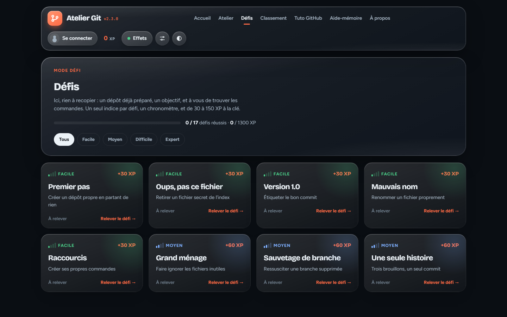

<div align="center">

<a href="https://titangp1.github.io/atelier-git/"></a>

# Atelier Git

**Apprendre Git en tapant de vraies commandes, directement dans le navigateur.**

[](https://github.com/Titangp1/atelier-git/releases)
[](https://titangp1.github.io/atelier-git/)
[](https://titangp1.github.io/atelier-git/atelier.html)
[](https://titangp1.github.io/atelier-git/defis.html)

[**▶ Ouvrir l'atelier**](https://titangp1.github.io/atelier-git/) · [Tuto GitHub](https://titangp1.github.io/atelier-git/github.html) · [Aide-mémoire](https://titangp1.github.io/atelier-git/aide-memoire.html) · [Classement](https://titangp1.github.io/atelier-git/classement.html)

Réalisé par **Titan_gp1**

</div>

---

## Aperçu

<p align="center"></p>

<table>
  <tr>
    <td width="50%"></td>
    <td width="50%"></td>
  </tr>
  <tr>
    <td align="center"><sub>L'accueil</sub></td>
    <td align="center"><sub>Les défis, de Facile à Expert</sub></td>
  </tr>
</table>

## ✨ Ce qu'on y trouve

| | |
|---|---|
| 📚 **15 leçons guidées** | Du premier `git init` au `rebase`, avec une explication courte et des missions qui se valident toutes seules. |
| 🏆 **17 défis** | Un dépôt préparé, un objectif, aucune commande imposée. De 30 à 150 XP selon la difficulté. |
| 🐙 **Tuto GitHub** | Pour de vrai : créer son compte, installer Git, se connecter, faire son premier `push`, régler les erreurs fréquentes. |
| 💻 **Terminal simulé** | Les vrais messages de Git, avec des astuces en français en cas d'erreur. |
| 🌳 **Graphe en direct** | Les commits, les branches et les trois zones (travail, index, dépôt) réagissent à chaque commande. |
| 👤 **Comptes et classement** | Connexion par email ou Google, XP vérifiés par le serveur, classement public. |
| ⚙️ **Options** | Taille du terminal, texte agrandi, animations réduites, mode expert sans indices, thème clair ou sombre. |

> [!NOTE]
> Pas de copier-coller : les commandes s'apprennent en les tapant. Un indice se dévoile à la demande si vous bloquez.

### Le parcours

| Débutant | Intermédiaire | Avancé |
|---|---|---|
| Votre premier dépôt | Versions et annulation | Travailler à plusieurs |
| Configurer Git | Les branches | Publier sur GitHub |
| Les trois zones | Fusionner des branches | Mettre de côté (`stash`) |
| Renommer et supprimer | Résoudre un conflit | Un historique linéaire (`rebase`) |
| Voyager dans l'historique | Ignorer et enquêter | Réparer ses erreurs |

Plus un **bac à sable** pour tout essayer librement.

### Raccourcis

| Touche | Action |
|---|---|
| <kbd>/</kbd> | Revenir au terminal |
| <kbd>↑</kbd> <kbd>↓</kbd> | Historique des commandes |
| <kbd>Tab</kbd> | Compléter |
| <kbd>Ctrl</kbd>+<kbd>C</kbd> | Annuler la ligne en cours |

## 🗂️ Les pages

| Page | Fichier | Contenu |
|---|---|---|
| Accueil | `index.html` | Présentation, démo animée, progression, parcours |
| Atelier | `atelier.html` | Leçons, terminal, graphe. Chaque leçon a son adresse : `atelier.html#branches` |
| Défis | `defis.html` | Les 17 défis par difficulté |
| Classement | `classement.html` | Les joueurs rangés par XP |
| Tuto GitHub | `github.html` | Relier un vrai dossier à un vrai dépôt GitHub |
| Aide-mémoire | `aide-memoire.html` | Toutes les commandes, avec une recherche |
| Compte | `compte.html` | Inscription, connexion, pseudo, suppression |
| À propos | `a-propos.html` | Crédits et historique des versions |

Le code est dans `assets/` : `style.css` (style commun), `site.js` (code partagé), `atelier.js` (moteur Git, leçons et défis), `pages.js` (code des autres pages).

## 🚀 Lancer en local

Aucune installation : double-cliquez sur `index.html`. Pour que les comptes marchent, servez plutôt le dossier :

```bash
python -m http.server 8000
```

puis ouvrez <http://localhost:8000>.

## 🔐 Comptes et classement (Firebase)

<details>
<summary>Mise en place dans la console Firebase</summary>

1. Créer un projet, y ajouter une application **Web** et copier son objet `firebaseConfig`.
2. *Authentication → Sign-in method* : activer **Adresse e-mail/Mot de passe** et **Google**.
3. *Authentication → Paramètres → Domaines autorisés* : ajouter `titangp1.github.io`.
4. *Firestore Database* : créer la base en mode production.
5. *Firestore → Règles* : coller le contenu de `firebase/firestore.rules`, puis **Publier**.
6. Coller l'objet `firebaseConfig` dans `assets/config.js`.

</details>

> [!IMPORTANT]
> Après chaque modification de `firebase/firestore.rules`, recollez le fichier dans *Firestore → Règles* et publiez.

La configuration Web de Firebase est publique par conception : la sécurité vient des règles. Elles vérifient que chacun ne modifie que son propre profil, que les XP correspondent exactement aux leçons et défis réussis (2100 XP au maximum), que la progression ne peut que grandir et que chaque pseudo est unique. Aucun email n'est stocké dans le classement. Sans compte, rien n'est gardé.

## 🧰 Commandes simulées

`init` `clone` `config` `status` `add` `rm` `mv` `commit` `restore` `reset` `clean` `log` `show` `diff` `blame` `reflog` `branch` `switch` `checkout` `merge` `rebase` `cherry-pick` `revert` `stash` `tag` `remote` `push` `fetch` `pull`, les alias et `.gitignore`.

Les modes interactifs (`git add -p`, `git rebase -i`) ne sont pas simulés : l'atelier explique ce qu'ils font.

## 📜 Historique des versions

<details open>
<summary><b>v2.3.0</b> · Tuto GitHub, leçons et options</summary>

- Nouvelle page **Tuto GitHub** : du compte au premier `push`, avec votre pseudo et votre dépôt dans les commandes.
- 4 leçons : Configurer Git, Renommer et supprimer, Versions et annulation, Publier sur GitHub.
- 6 défis : Mauvais nom, Raccourcis, Fuite de clé, Urgence en plein travail, Mise en ligne, Ligne droite.
- Panneau **Options**. Règles Firestore mises à jour.

</details>

<details>
<summary><b>v2.2.0</b> · Défis et animations</summary>

- Onze défis de Facile à Expert, de 30 à 150 XP, avec indice et chronomètre.
- Nombre de joueurs inscrits affiché sur tout le site.
- Transitions entre les pages, confettis, compteurs animés, « +XP » qui s'envole.
- La progression n'est gardée que sur un compte connecté.

</details>

<details>
<summary><b>v2.1.0</b> · Comptes et classement</summary>

- Inscription avec un pseudo, connexion par email ou Google, suppression du compte.
- Classement par XP avec médailles et rang personnel ; XP vérifiés par les règles Firestore.

</details>

<details>
<summary><b>v2.0.0 et avant</b></summary>

- **2.0.0** : le site passe en plusieurs pages ; plus aucune commande ne s'écrit toute seule.
- **1.4.0** : écran de chargement, copier-coller désactivé, <kbd>Ctrl</kbd>+<kbd>C</kbd> dans le terminal.
- **1.3.0** : page beaucoup plus fluide, bouton « Effets », frappe fluide façon macOS.
- **1.2.0** : deux leçons, `.gitignore`, `reflog`, `blame`, `cherry-pick` et de nombreuses options.
- **1.1.0** : corrections, accessibilité, vraie réfraction du verre.
- **1.0.0** : première version, 9 leçons et bac à sable.

</details>

## 🙏 Crédits

Conçu et réalisé par **Titan_gp1**.

- Réfraction du verre portée de [liquid-glass-js](https://github.com/dashersw/liquid-glass-js) (© 2025 Armagan Amcalar, licence MIT).
- Aide-mémoire organisé d'après celui de [git-scm.com](https://git-scm.com/cheat-sheet).
- Polices : Bricolage Grotesque, Figtree et JetBrains Mono (Google Fonts).
