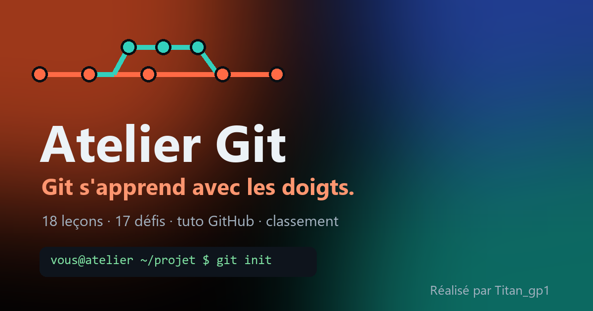
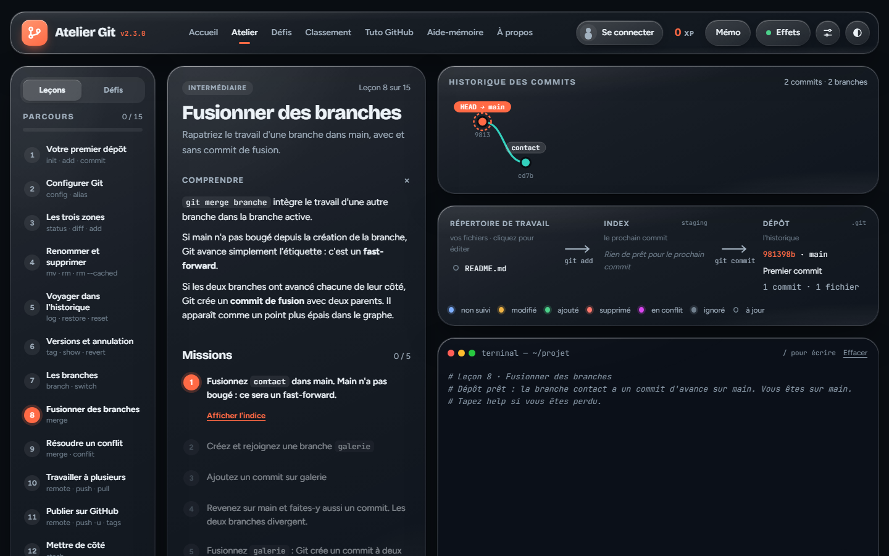
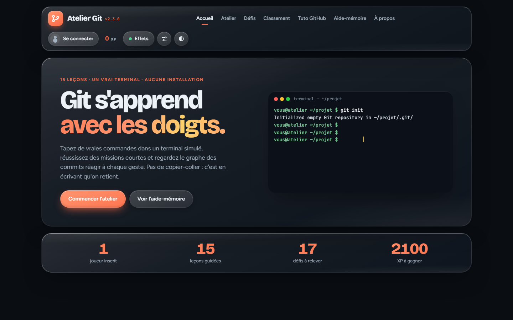
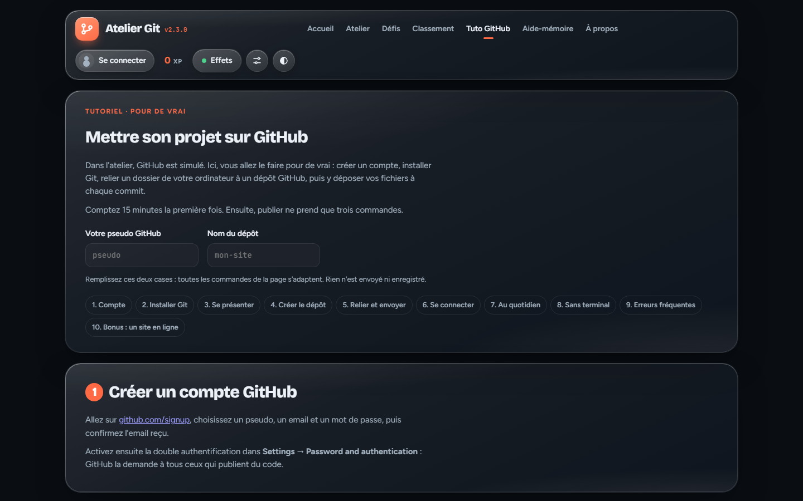

<div align="center">

<a href="https://titangp1.github.io/atelier-git/"></a>

<h1>Atelier Git</h1>

<p><b>Apprendre Git en tapant de vraies commandes, directement dans le navigateur.</b></p>

<p>
<a href="https://titangp1.github.io/atelier-git/"></a>


</p>

<p>
<a href="https://titangp1.github.io/atelier-git/atelier.html">Atelier</a> ·
<a href="https://titangp1.github.io/atelier-git/defis.html">Défis</a> ·
<a href="https://titangp1.github.io/atelier-git/github.html">Tuto GitHub</a> ·
<a href="https://titangp1.github.io/atelier-git/aide-memoire.html">Aide-mémoire</a> ·
<a href="https://titangp1.github.io/atelier-git/classement.html">Classement</a>
</p>

<sub>Réalisé par <b>Titan_gp1</b></sub>

</div>

<br>



## Sommaire

- [Présentation](#présentation)
- [Captures](#captures)
- [Le parcours](#le-parcours)
- [Les défis](#les-défis)
- [Les pages](#les-pages)
- [Lancer en local](#lancer-en-local)
- [Comptes et classement](#comptes-et-classement)
- [Commandes simulées](#commandes-simulées)
- [Versions](#versions)
- [Crédits](#crédits)

## Présentation

Atelier Git simule un dépôt, un terminal et un serveur distant dans le navigateur. On tape de vraies commandes, et le graphe des commits montre aussitôt ce qu'elles changent.

| Fonction | Détail |
|:--|:--|
| **18 leçons** | Une explication courte, puis des missions qui se valident toutes seules. |
| **17 défis** | Un dépôt préparé, un objectif, aucune commande imposée. De 30 à 150 XP. |
| **Tuto GitHub** | Pour de vrai : compte, installation, connexion, premier `push`, erreurs fréquentes. |
| **Terminal simulé** | Les vrais messages de Git, avec des astuces en français. |
| **Graphe en direct** | Commits, branches et trois zones (travail, index, dépôt) mis à jour à chaque commande. |
| **Comptes** | Connexion par email ou Google, XP vérifiés par le serveur, classement public. |
| **Options** | Taille du terminal, texte agrandi, animations réduites, mode expert, thème clair ou sombre. |

> [!NOTE]
> Le copier-coller est désactivé : les commandes s'apprennent en les tapant. Un indice se dévoile à la demande.

| Raccourci | Action |
|:--|:--|
| <kbd>/</kbd> | Revenir au terminal |
| <kbd>↑</kbd> <kbd>↓</kbd> | Historique des commandes |
| <kbd>Tab</kbd> | Compléter une commande |
| <kbd>Ctrl</kbd> + <kbd>C</kbd> | Annuler la ligne en cours |

## Captures

<table>
  <tr>
    <td width="50%" align="center"><br><sub><b>Accueil</b></sub></td>
    <td width="50%" align="center"><br><sub><b>Défis</b></sub></td>
  </tr>
  <tr>
    <td colspan="2" align="center"><br><sub><b>Tuto GitHub</b></sub></td>
  </tr>
</table>

## Le parcours

| # | Leçon | Commandes | Niveau | XP |
|:-:|:--|:--|:--|--:|
| 1 | Votre premier dépôt | `init` `add` `commit` | Débutant | 50 |
| 2 | Configurer Git | `config` alias | Débutant | 50 |
| 3 | Les trois zones | `status` `diff` `add` | Débutant | 50 |
| 4 | Renommer et supprimer | `mv` `rm` `rm --cached` | Débutant | 50 |
| 5 | Voyager dans l'historique | `log` `restore` `reset` | Débutant | 50 |
| 6 | Versions et annulation | `tag` `show` `revert` | Intermédiaire | 50 |
| 7 | Comparer des versions | `diff` `show --stat` | Intermédiaire | 50 |
| 8 | Annuler sans paniquer | `restore` `reset --soft` `revert` | Intermédiaire | 50 |
| 9 | Les branches | `branch` `switch` | Intermédiaire | 50 |
| 10 | Explorer le passé | `switch --detach` | Intermédiaire | 50 |
| 11 | Fusionner des branches | `merge` | Intermédiaire | 50 |
| 12 | Résoudre un conflit | `merge` conflit | Intermédiaire | 60 |
| 13 | Travailler à plusieurs | `remote` `push` `pull` | Avancé | 60 |
| 14 | Publier sur GitHub | `remote` `push -u` `--tags` | Avancé | 60 |
| 15 | Mettre de côté | `stash` | Avancé | 50 |
| 16 | Un historique linéaire | `rebase` | Avancé | 60 |
| 17 | Ignorer et enquêter | `.gitignore` `blame` | Intermédiaire | 50 |
| 18 | Réparer ses erreurs | `amend` `reflog` `cherry-pick` | Avancé | 60 |

Plus un **bac à sable** pour tout essayer librement.

## Les défis

| Difficulté | XP | Défis |
|:--|--:|:--|
| Facile | 30 | Premier pas · Oups, pas ce fichier · Version 1.0 · Mauvais nom · Raccourcis |
| Moyen | 60 | Grand ménage · Sauvetage de branche · Une seule histoire · Fuite de clé · Urgence en plein travail |
| Difficile | 100 | Double conflit · Le bon commit · Message honteux · Mise en ligne |
| Expert | 150 | Course contre Léa · Qui a cassé le site ? · Ligne droite |

Au total : **950 XP** de leçons + **1 300 XP** de défis = **2 250 XP**.

## Les pages

| Page | Fichier | Contenu |
|:--|:--|:--|
| Accueil | `index.html` | Présentation, démo animée, progression |
| Atelier | `atelier.html` | Leçons, terminal et graphe. Une adresse par leçon : `atelier.html#branches` |
| Défis | `defis.html` | Les 17 défis, filtrables par difficulté |
| Classement | `classement.html` | Les joueurs rangés par XP |
| Tuto GitHub | `github.html` | Relier un vrai dossier à un vrai dépôt GitHub |
| Aide-mémoire | `aide-memoire.html` | Toutes les commandes, avec une recherche |
| Compte | `compte.html` | Inscription, connexion, pseudo, suppression |
| À propos | `a-propos.html` | Crédits et historique des versions |

```text
atelier-git/
├── *.html               les 8 pages du site
├── assets/
│   ├── style.css        style commun
│   ├── site.js          code partagé (thème, effets, comptes, options)
│   ├── atelier.js       moteur Git simulé, leçons et défis
│   ├── pages.js         accueil, défis, classement, compte, tuto
│   └── config.js        configuration Firebase
├── firebase/
│   └── firestore.rules  règles de sécurité
└── docs/                captures du README
```

## Lancer en local

Aucune installation : ouvrez `index.html` dans un navigateur. Pour que les comptes fonctionnent, servez plutôt le dossier :

```bash
python -m http.server 8000
```

puis ouvrez <http://localhost:8000>.

## Comptes et classement

Les comptes passent par [Firebase](https://firebase.google.com) (offre gratuite) : *Authentication* pour la connexion, *Firestore* pour les profils.

<details>
<summary><b>Mise en place dans la console Firebase</b></summary>
<br>

1. Créer un projet, y ajouter une application **Web** et copier son objet `firebaseConfig`.
2. *Authentication → Sign-in method* : activer **E-mail/Mot de passe** et **Google**.
3. *Authentication → Paramètres → Domaines autorisés* : ajouter `titangp1.github.io`.
4. *Firestore Database* : créer la base en mode production.
5. *Firestore → Règles* : coller `firebase/firestore.rules`, puis **Publier**.
6. Coller l'objet `firebaseConfig` dans `assets/config.js`.

</details>

> [!IMPORTANT]
> Après chaque modification de `firebase/firestore.rules`, recollez le fichier dans *Firestore → Règles* et publiez.

**Sécurité.** La configuration Web de Firebase est publique par conception : la protection vient des règles. Chacun ne modifie que son propre profil, les XP doivent correspondre exactement aux leçons et défis réussis, la progression ne peut que grandir et chaque pseudo est unique. Aucun email n'est stocké dans le classement. Sans compte, rien n'est enregistré.

## Commandes simulées

`init` `clone` `config` `status` `add` `rm` `mv` `commit` `restore` `reset` `clean` `log` `show` `diff` `blame` `reflog` `branch` `switch` `checkout` `merge` `rebase` `cherry-pick` `revert` `stash` `tag` `remote` `push` `fetch` `pull`, les alias et `.gitignore`.

Les modes interactifs (`git add -p`, `git rebase -i`) ne sont pas simulés : l'atelier explique ce qu'ils font.

## Versions

| Version | Nouveautés |
|:--|:--|
| **2.4.0** | 3 leçons : Comparer des versions, Annuler sans paniquer, Explorer le passé · barre du haut sur une ligne · rendu plus léger |
| 2.3.0 | Page Tuto GitHub · 4 leçons · 6 défis · panneau Options · pastilles de couleur dans les zones |
| 2.2.0 | 11 défis · nombre de joueurs · animations · progression gardée uniquement sur le compte |
| 2.1.0 | Comptes (email et Google) · classement · XP vérifiés par le serveur |
| 2.0.0 | Site en plusieurs pages · plus aucune commande insérée automatiquement |
| 1.4.0 | Écran de chargement · copier-coller désactivé |
| 1.3.0 | Fluidité · bouton Effets · frappe façon macOS |
| 1.2.0 | 2 leçons · `.gitignore`, `reflog`, `blame`, `cherry-pick` |
| 1.1.0 | Corrections · accessibilité · réfraction du verre |
| 1.0.0 | Première version : 9 leçons et bac à sable |

## Crédits

Conçu et réalisé par **Titan_gp1**.

- Réfraction du verre portée de [liquid-glass-js](https://github.com/dashersw/liquid-glass-js) (© 2025 Armagan Amcalar, licence MIT).
- Aide-mémoire organisé d'après celui de [git-scm.com](https://git-scm.com/cheat-sheet).
- Polices : Bricolage Grotesque, Figtree et JetBrains Mono (Google Fonts).

<div align="center"><sub>Atelier Git · v2.4.0 · Titan_gp1</sub></div>
